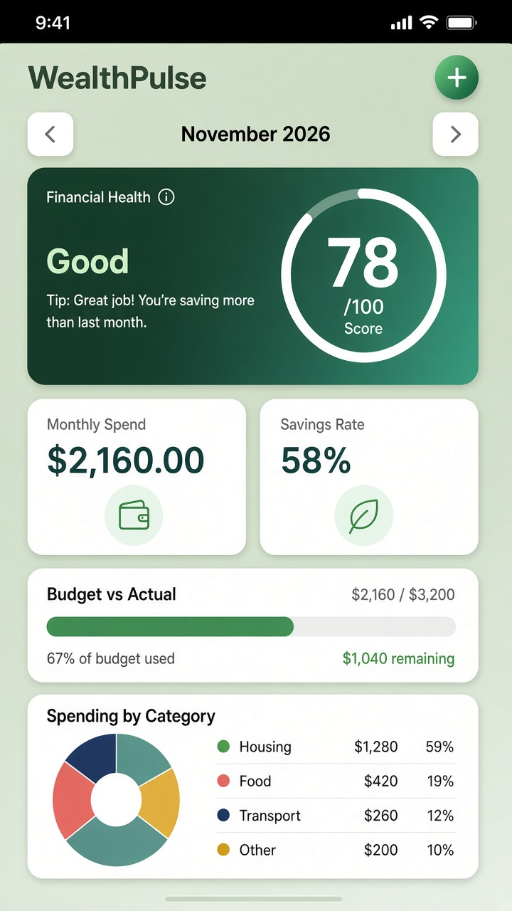

# WealthPulse

SwiftUI iOS finance tracker for fast expense logging and a clear monthly money overview.

<p align="center">
  
</p>

## Features

- **Dashboard** — monthly spending, budget vs actual, savings rate, category pie chart, net worth trend, financial health score
- **Expenses** — add / edit / delete income & expenses with search and filters
- **Budget** — overall monthly limit plus optional per-category caps
- **Categories** — built-in set plus custom icons & colors
- **Net Worth** — asset/liability snapshots with trend chart
- **Financial Health Score** — 0–100 score from budget adherence, savings rate, spending mix, and net worth trend

## Requirements

- macOS with **Xcode 15+**
- iOS **17.0+** (Simulator or device)

## Open & Run

1. Open `WealthPulse.xcodeproj` in Xcode
2. Select an iPhone simulator (or your device)
3. Set your **Signing Team** under the WealthPulse target if needed
4. Press **Run** (⌘R)

Sample transactions, a monthly budget, and net worth history load on first launch so the dashboard is populated immediately.

## Project structure

```
WealthPulse/
├── Models/           # Expense, Category, Budget, Net Worth, Health
├── Services/         # FinanceStore (persistence + calculations)
├── Utilities/        # Theme, formatters, Color helpers
└── Views/
    ├── Dashboard/
    ├── Expenses/
    ├── Budget/
    ├── Categories/
    ├── NetWorth/
    └── Components/   # Charts, metric cards, health ring
```

Data is stored locally with `UserDefaults` via `Codable`.
